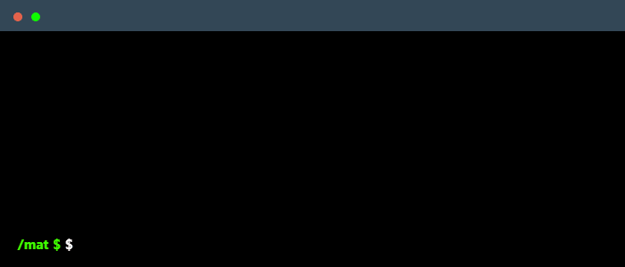

<h1 align="center">Mateus Cerqueira</h1>

  ═══════════ | QA Tester · Automação Web · API · Mobile | ═══════════

  

---

══════════ | Stack & Ferramentas | ══════════

**🤖 Automação & Testes**

**🔌 API & Carga**

**🛡️ Segurança & Qualidade**

**💻 Linguagens & Ferramentas**

---

══════════ | Projetos em Destaque | ══════════

| 🧪 Projeto | Descrição | Stack |
|---|---|---|
| **[lootbox-api-restassured-tests](https://github.com/MateusCerqueiraG/lootbox-api-restassured-tests)** | Automação de API REST com suíte CRUD completa, arquitetura Services/Models e limpeza automática de dados | `Java` · `REST-assured` · `JUnit 5` |
| **[Testes-Selenium](https://github.com/MateusCerqueiraG/Testes-Selenium)** | Automação Web E2E de fluxos críticos (login, pedidos), cobrindo exceção e caminho feliz | `Selenium` · `JavaScript` |
| **[API-POKEQATEST-POSTMAN](https://github.com/MateusCerqueiraG/API-POKEQATEST-POSTMAN)** | Suíte de testes de API no Postman — CRUD, asserts de tempo de resposta e workflow encadeado | `Postman` · `JavaScript` |
| **[gherkin-coupon-ecommerce](https://github.com/MateusCerqueiraG/gherkin-coupon-ecommerce)** | BDD/Gherkin: regras de negócio de cupons com matriz de rastreabilidade | `Gherkin` · `Cucumber` |
| **[jira-kanban-agendamento-servicos](https://github.com/MateusCerqueiraG/jira-kanban-agendamento-servicos)** | Gestão ágil e engenharia de requisitos — Épicos, Kanban e User Stories | `Jira` · `Agile` |

> 🚧 **Em evolução:** automação E2E em **Python** (Behave + Selenium, POM), **testes de carga com Locust** e **segurança (OWASP)** — novos repositórios a caminho.

---

══════════ | GitHub Stats | ══════════

---

  ════════════════ | Contato | ════════════════
    

  

---
