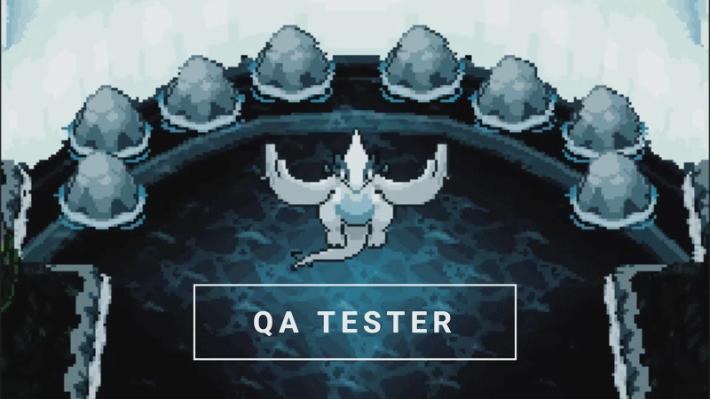
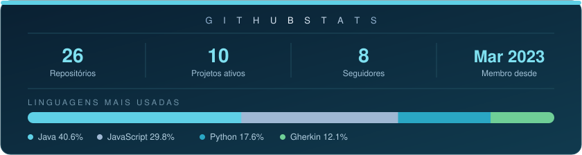

<h1 align="center">Mateus Cerqueira</h1>

  ═══════════ | QA Tester · Automação Web · API · Mobile | ═══════════

  

---

══════════ | Stack & Ferramentas | ══════════

**🤖 Automação & Testes**

**🔌 API & Carga**

**🛡️ Segurança & Qualidade**

**💻 Linguagens & Ferramentas**

---

══════════ | GitHub Stats | ══════════

---

  ════════════════ | Contato | ════════════════
    

  

---
